# Smart Home IoT Data Engine
## Project Functionalities & Review Documentation

This document outlines the core capabilities of the Smart Home IoT Data Engine, divided into User-Defined Functionalities (Application Tier) and NoSQL Functionalities (Database Tier).

---

### Part 1: User-Defined Functionalities (Application Tier)

#### 1. Interactive Dashboard Monitoring
A real-time visualization interface styled as a physical breaker panel. It features animated temperature gauges, motion detection indicators, and lock switches. The dashboard receives sub-second updates via WebSocket, reflecting the physical state of the house instantaneously.

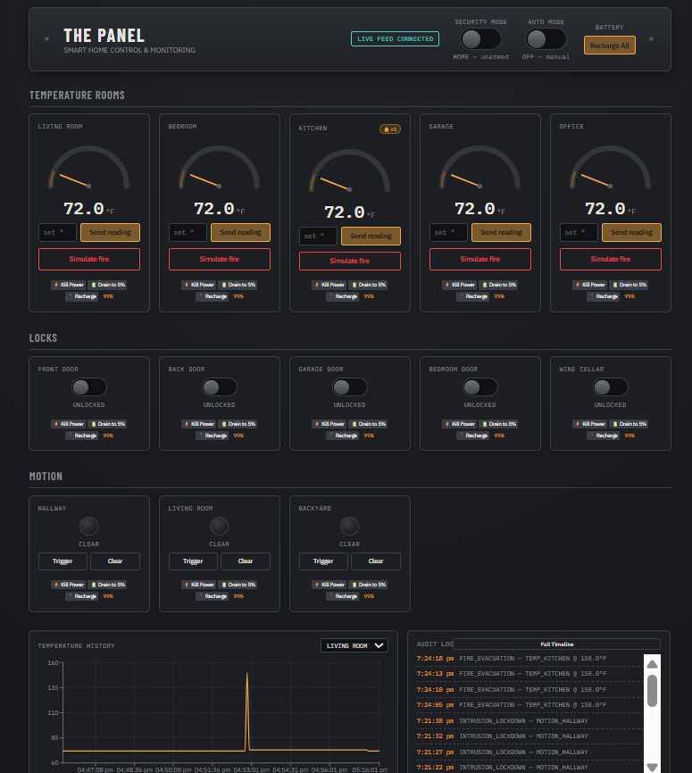

#### 2. "Away Mode" Security Automation
A system-wide security toggle that arms the house. When switched from "HOME" to "AWAY", the system automatically engages all smart locks and primes the motion sensors to detect unauthorized movement, logging any suspicious activity.

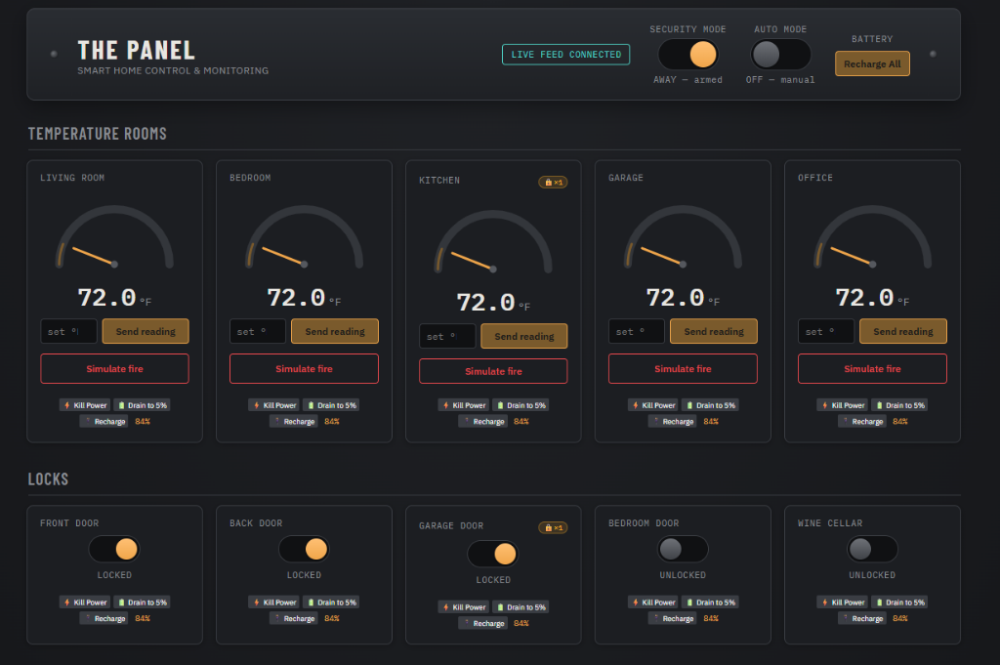

#### 3. Hardware Simulation & Debug Controls
A built-in developer toolkit allowing users to manually trigger events, simulate hardware failures (like draining a battery to 5%), and sever network connections (killing power). This allows real-time testing of the system's resilience.

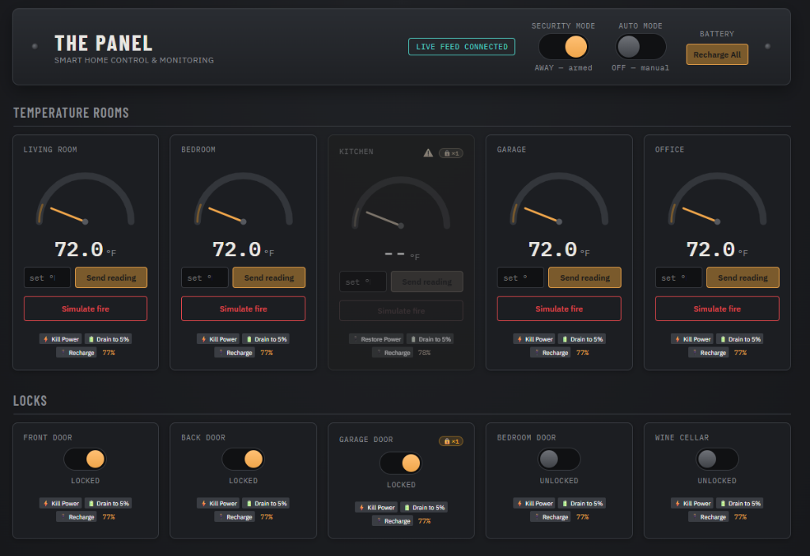

#### 4. Autonomous Fire Evacuation Protocol (Advanced)
A safety-critical automation system that actively listens for ambient temperatures exceeding 100°F. When triggered, it automatically unlocks *only* the designated exit route doors (Front Door, Garage Door) to allow escape, while keeping non-essential rooms locked. It instantly triggers a global klaxon alert across the UI.

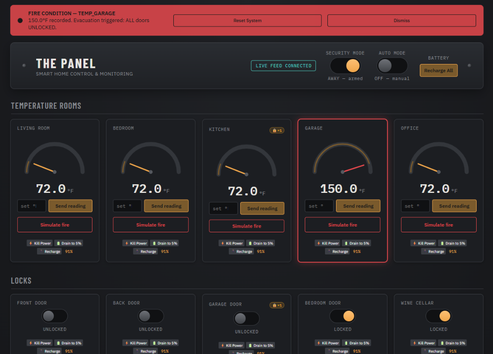

*Note on Architecture (Future Improvement)*: Currently, the fire protocol uses **Document-Level Metadata** to ensure authorized exit doors do not trigger the burglar alarm (stamping documents with a `lockdownTriggeredAt` timestamp). A robust future improvement would be implementing a **Global State Machine** that transitions the entire `home_status` from `AWAY` to a dedicated `FIRE_EVACUATION` mode, entirely bypassing standard security logic at a global level rather than the document level.

#### 5. Intelligent Sensor Quarantine (Advanced)
A self-healing rate-limiter that detects erratic or malfunctioning sensors flooding the network (e.g., a short-circuiting motion sensor sending 50 signals a second). It visually isolates the malfunctioning sensor in a "Quarantine" mode (amber pulsing UI) to prevent false alarms, while intelligently bypassing this limit if it detects an actual emergency like a fire.

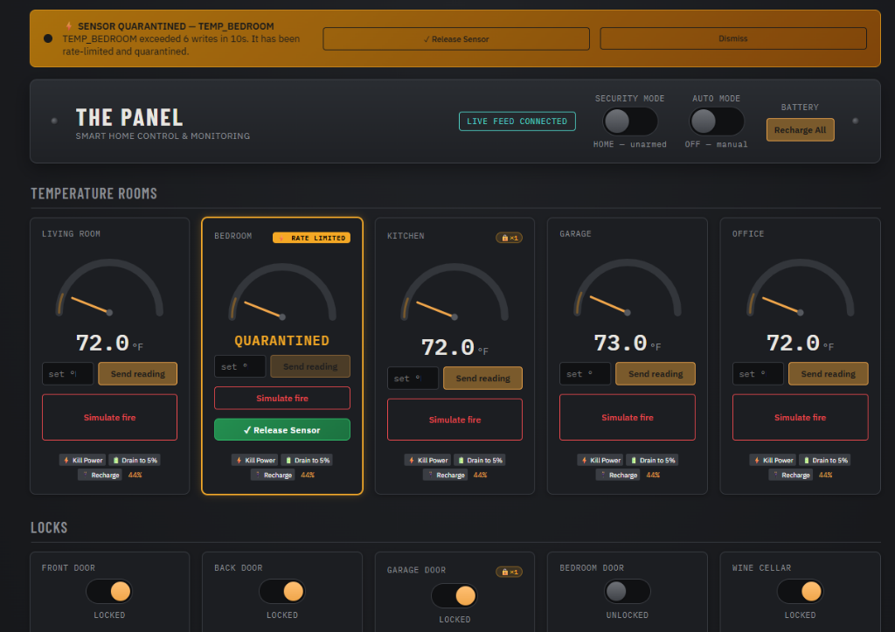

#### 6. Full-Text Audit Logging Timeline
A scrollable, reverse-chronological timeline located on the dashboard that records all critical system events (lock toggles, fire conditions, intrusion alerts, rate limits). This provides users with an exact, timestamped history of the smart home's behavior.

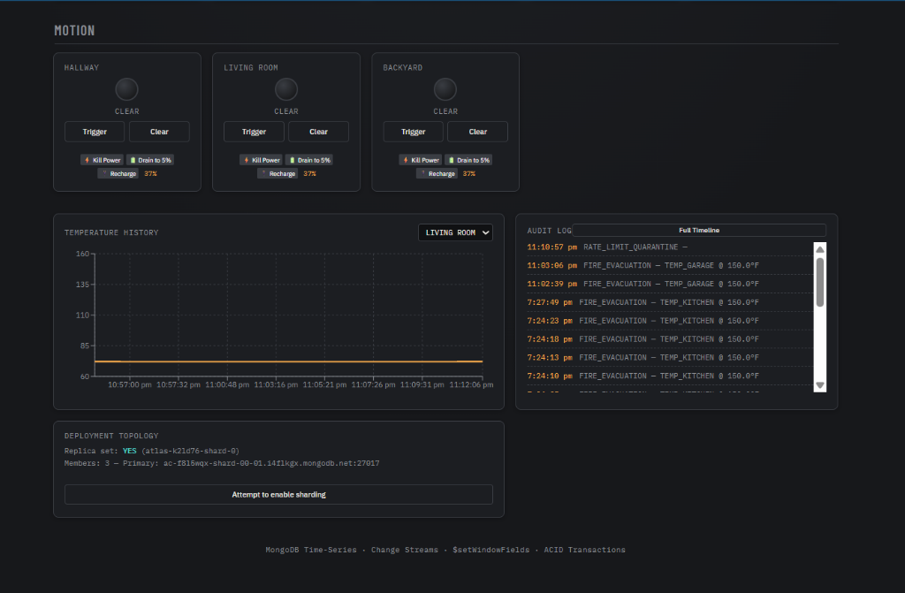

#### 7. Automated Background Telemetry Engine
A self-driving "Auto Mode" toggle that procedurally generates realistic home behavior. When enabled, it orchestrates randomized temperature fluctuations, periodic motion events, and lock checks entirely in the background, simulating a living environment without requiring the user to manually click buttons.

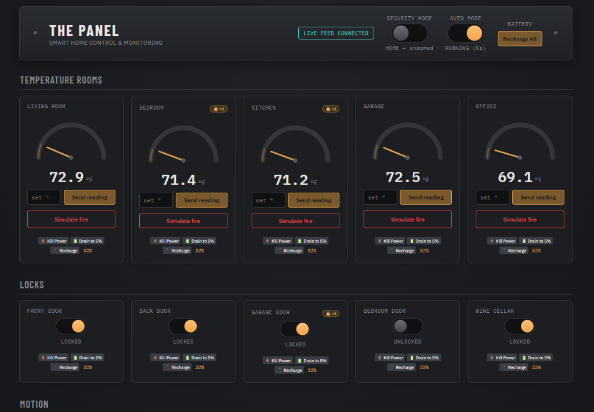

---

### Part 2: NoSQL Functionalities (Database Tier)

#### 8. Strict BSON Schema Validation
While MongoDB is schema-less by default, the system enforces strict data integrity on the `sensor_data` collection using BSON `$jsonSchema` validation. This guarantees that all IoT telemetry data injected into the database conforms to required types (e.g., `temperature` must be a double), preventing corrupted sensor readings from entering the pipeline.

```java
// BSON Schema Validation Enforcement
ValidationOptions validationOptions = new ValidationOptions()
        .validator(new Document("$jsonSchema", schema))
        .validationLevel(ValidationLevel.MODERATE);

CreateCollectionOptions options = new CreateCollectionOptions()
        .validationOptions(validationOptions);
database.createCollection("sensor_data", options);
```
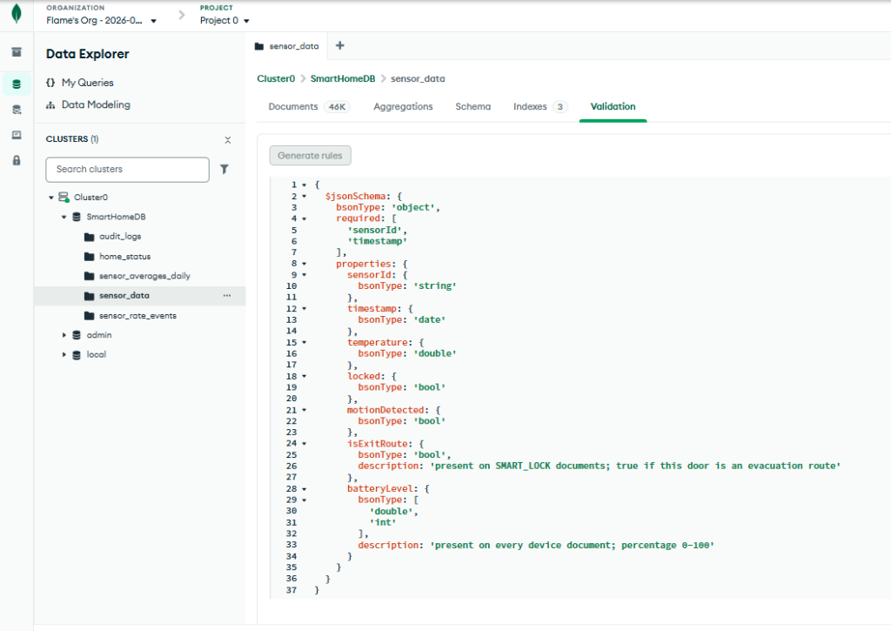

#### 9. Real-Time Change Streams
Instead of relying on inefficient polling (querying the database every second), the backend utilizes MongoDB Change Streams. The database natively pushes an event to the backend the millisecond a new reading or alert is inserted, driving the event-driven WebSocket architecture.

```java
// Listening to the MongoDB Change Stream
List<Document> insertOnlyPipeline = List.of(
        new Document("$match", new Document("operationType", "insert"))
);

ChangeStreamIterable<Document> changeStream = sensorCollection.watch(insertOnlyPipeline);
MongoChangeStreamCursor<ChangeStreamDocument<Document>> cursor = changeStream.cursor();

while (cursor.hasNext()) {
    ChangeStreamDocument<Document> change = cursor.next();
    processRealTimeEvent(change);
}
```
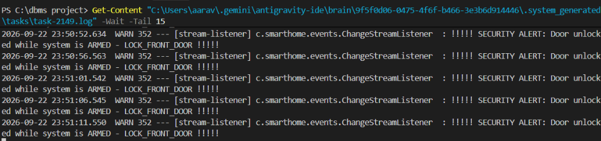

#### 10. Multi-Document ACID Transactions
Used during critical system procedures like global lockdowns. The system uses multi-document transactions to ensure that when it attempts to lock multiple doors, either *all* doors lock successfully, or the entire operation rolls back. This prevents a dangerous partially-locked state during an emergency.

```java
// Native MongoDB Multi-Document ACID Transaction
ClientSessionOptions sessionOptions = ClientSessionOptions.builder().causallyConsistent(true).build();

try (ClientSession session = client.startSession(sessionOptions)) {
    session.withTransaction(() -> {
        // Insert audit log
        auditLogs.insertOne(session, fireEvent);

        // Update all doors within the same transaction
        for (var entry : com.smarthome.AppConfig.LOCK_EXIT_ROUTES.entrySet()) {
            sensorData.insertOne(session, lockDoc);
        }
        return "Transaction Complete";
    });
}
```
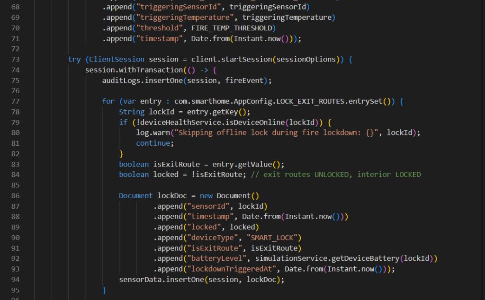

#### 11. TTL (Time-To-Live) Sliding Windows
The sensor rate-limiter is implemented entirely via the database using a TTL index. Write events are inserted into a `sensor_rate_events` collection with a 10-second TTL. MongoDB automatically purges old records, creating a highly efficient, database-native sliding window without requiring background cron jobs.

```java
// Creating the TTL Index (10-second Sliding Window)
IndexOptions ttlOptions = new IndexOptions().expireAfter(10L, TimeUnit.SECONDS);
database.getCollection("sensor_rate_events").createIndex(
    new Document("createdAt", 1), ttlOptions
);
```
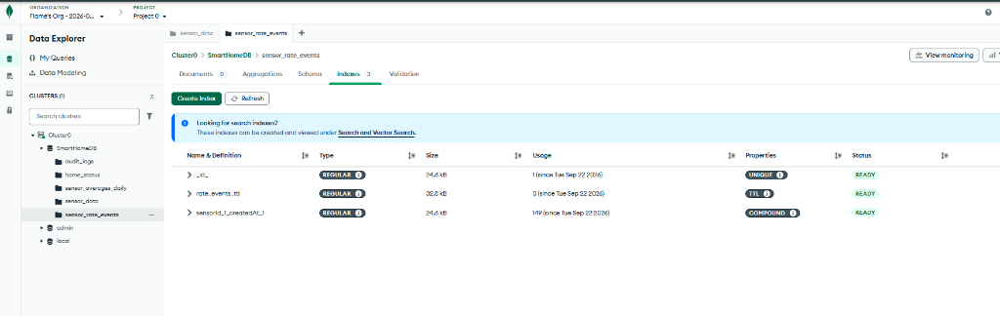

#### 12. Wildcard `$**` Text Indexing
The system features a logarithmic full-text search across the unstructured `audit_logs` collection. By implementing a wildcard Text Index, the system can instantly tokenize and search for complex event logs (like `INTRUSION_LOCKDOWN`), bypassing the massive O(N) performance penalty of standard regex scans.

```java
// Creating the Wildcard Text Index
IndexOptions textIndexOptions = new IndexOptions().name("audit_text_index");
database.getCollection(AUDIT_LOGS_COLLECTION).createIndex(
    new Document("$**", "text"), textIndexOptions
);
```
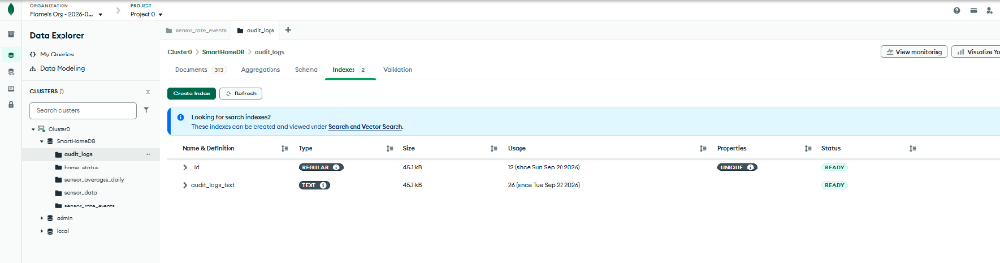

#### 13. Aggregation Pipeline Analytics
The backend runs scheduled tasks using MongoDB's Aggregation Framework (utilizing operators like `$match`, `$group`, and `$avg`) to calculate rolling daily averages for temperature sensors. This processes massive datasets natively on the database side, preventing memory overload on the backend server.

```java
// Advanced Aggregation Pipeline using $setWindowFields and $merge
Document setWindowFieldsStage = new Document("$setWindowFields", new Document()
        .append("partitionBy", "$sensorId")
        .append("sortBy", new Document("timestamp", 1))
        .append("output", new Document("rollingAvgTemp", new Document()
                .append("$avg", "$temperature")
                .append("window", new Document()
                        .append("range", List.of(-5, "current"))
                        .append("unit", "minute")))));

Document mergeStage = new Document("$merge", new Document()
        .append("into", SENSOR_AVERAGES_COLLECTION)
        .append("on", List.of("sensorId", "timestamp"))
        .append("whenMatched", "replace"));
```
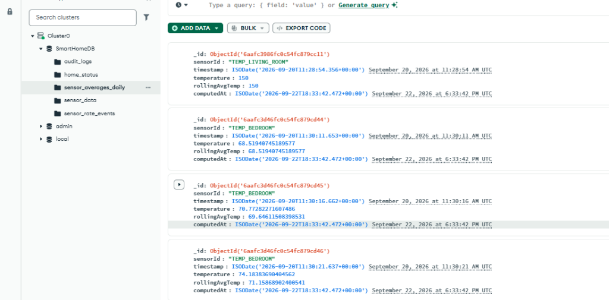

#### 14. Compound Indexing for High-Performance Sorting
To ensure the dashboard renders historical charts instantly, the system applies Compound Indexes (e.g., `sensorId_1_timestamp_-1`) to the collections. This guarantees that querying the "latest 30 readings for a specific room" is an O(1) indexed operation rather than a slow collection scan.

```java
// Creating a Compound Index for Fast Time-based Queries
database.getCollection(SENSOR_DATA_COLLECTION).createIndex(
    Indexes.compoundIndex(
        Indexes.ascending("sensorId"),
        Indexes.descending("timestamp")
    )
);
```
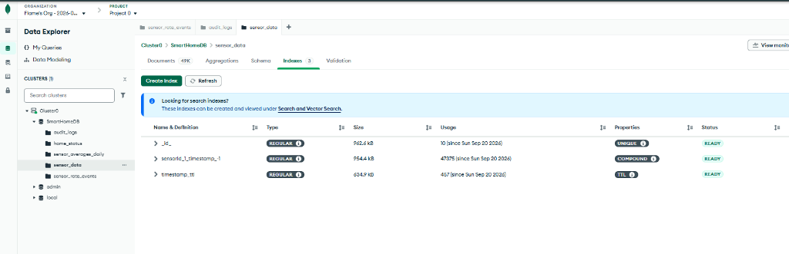

