# Smart Home IoT Data Engine
## Project Functionalities & Review 3 Documentation

This document outlines the core capabilities of the Smart Home IoT Data Engine for Review 3, divided into User-Defined Functionalities (Application Tier) and NoSQL Functionalities (Database Tier). All functionalities presented here are brand-new and distinct from Review 2.

---

### Part 1: User-Defined Functionalities (Application Tier)

#### 1. Interactive Temporal Thermal History Charting & Trend Analysis
An interactive time-series telemetry visualization that dynamically plots ambient temperature variations over a rolling 30-minute window for any selected room. Operators can switch between rooms and inspect live bezier trendlines to detect rapid thermal spikes rather than relying solely on instantaneous readings.

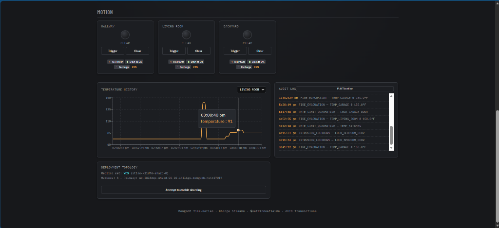

#### 2. Autonomous Intrusion Lockdown Protocol & Optical Motion Sensing (`MotionLamp`)
Optical motion detection subsystem with live state indicators (`MOTION` vs `CLEAR`). When the house security perimeter is armed in "AWAY" mode, detecting motion triggers an instant intrusion lockdown protocol, sounds a global flashing klaxon alert, flashes all door breakers to locked, and records an emergency `INTRUSION_LOCKDOWN` incident.

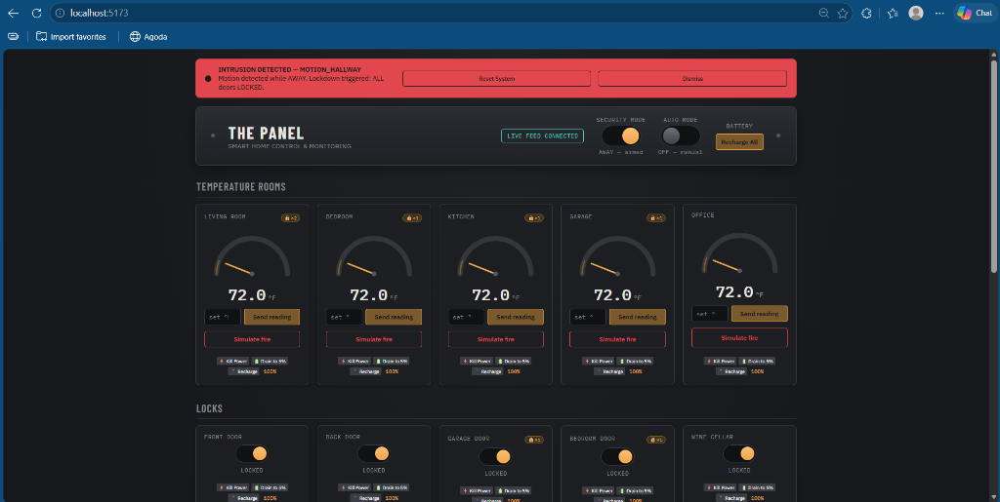

#### 3. Life-Safety Hardware Fault Isolation Protocol (`EXIT_LOCK_FAILURE`)
A fail-operational safety mechanism designed for physical emergencies. If an exit route door (such as the Front Door or Garage Door) is unpowered, dead, or disconnected during a fire evacuation, the system catches the hardware failure without aborting the transaction, records a dedicated audit log, and raises a critical emergency warning banner notifying occupants that a specific exit is blocked.

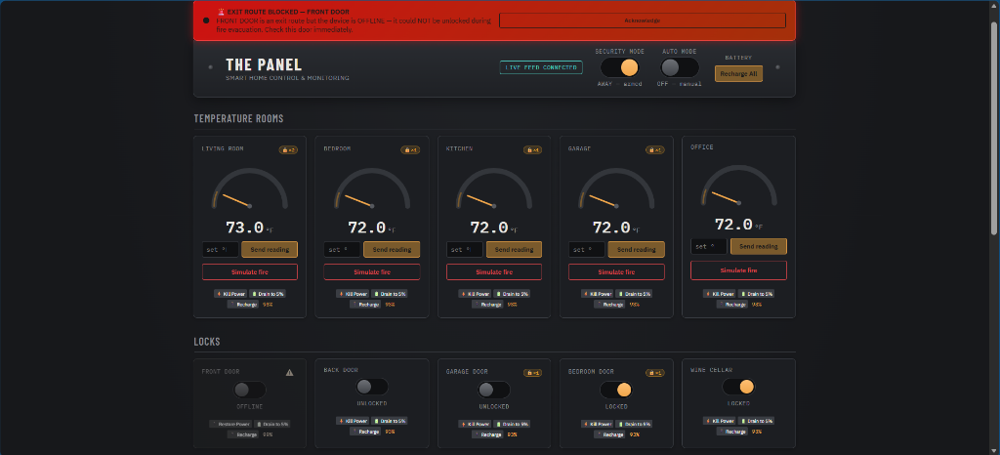

#### 4. Interactive Full-Text Audit Search Modal with Live Pagination
A dedicated full-screen Timeline Modal allowing users to type dynamic keyword queries (e.g. `INTRUSION`, `FIRE`, `RATE_LIMIT`) and paginate (`Load More`) through historical security incidents with instant sub-millisecond filtering backed by MongoDB full-text index querying.

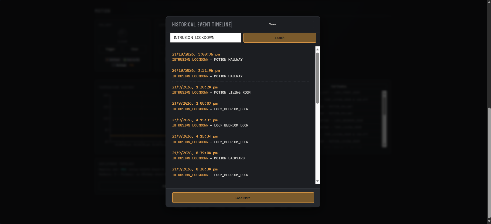

#### 5. Historical Quarantine Frequency Tracking (`🔒×N`) & Manual Sensor Release
Tracks how many times each sensor has malfunctioned historically (`🔒×N` badge on the card), and provides a `✓ Release Sensor` button to manually restore service and clear rate-limit events from the database once hardware is serviced.

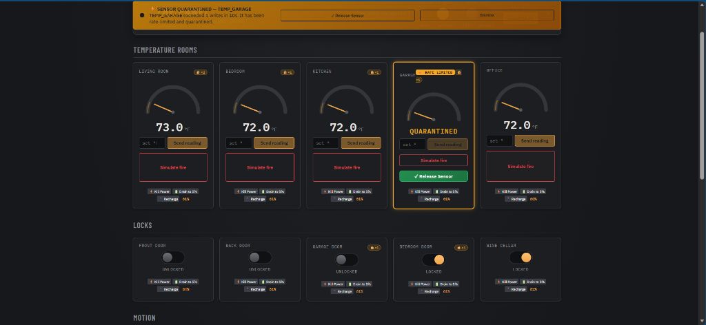

#### 6. Cluster Deployment Topology & Health Monitor Card
An integrated real-time cluster health panel on the frontend displaying the active MongoDB deployment topology, replica set status (`rs0`), primary node hostname, and cluster voting member count.


#### 7. Granular Per-Room Simulation Masking (Auto-Mode Lamp Toggle)
A granular simulation control allowing the operator to selectively include or exclude individual rooms from background telemetry generation by toggling the green indicator lamp on each gauge card, isolating specific rooms for focused testing.

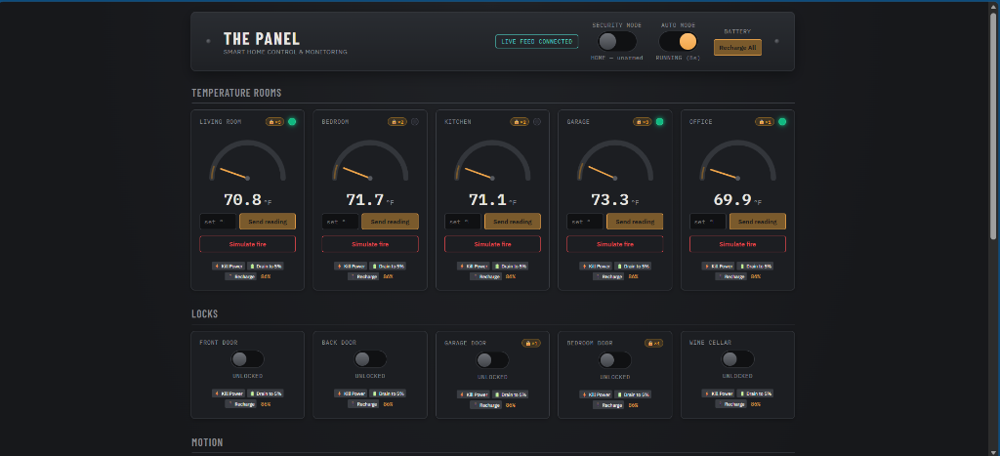

---

### Part 2: NoSQL Functionalities (Database Tier)

#### 8. Live Replica Set Distributed Topology Inspection (`hello` Admin Command)
Direct programmatic inspection of MongoDB distributed consensus. The backend issues the low-level administrative `hello` command against MongoDB Atlas to verify active replica set election, cluster primary node hostname, writable status, and the quorum of active voting members required for Change Streams and ACID transactions.

```java
// Inspecting MongoDB Distributed Consensus via the 'hello' Admin Command
Document result = database.runCommand(new Document("hello", 1));
String setName = result.getString("setName");
List<String> hosts = result.getList("hosts", String.class, List.of());
String primary = result.getString("primary");
Boolean isWritablePrimary = result.getBoolean("isWritablePrimary");
```

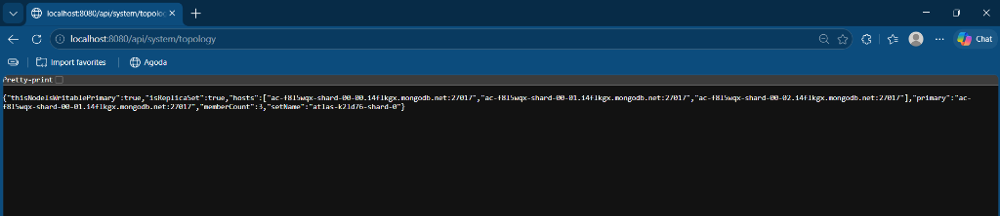

#### 9. Horizontal Cluster Sharding Administration & Hash Key Partitioning
Demonstrates horizontal distributed database scaling by executing real administrative `enableSharding` and `shardCollection` commands with a hashed partition key (`{ sensorId: "hashed" }`). This illustrates how high-velocity IoT streams avoid monotonic timestamp insertion bottlenecks and distribute writes uniformly across cluster shards.

```java
// Executing Horizontal Cluster Sharding with a Hashed Key
adminDatabase.runCommand(new Document("enableSharding", DATABASE_NAME));
adminDatabase.runCommand(new Document("shardCollection", DATABASE_NAME + "." + SENSOR_DATA_COLLECTION)
        .append("key", new Document("sensorId", "hashed")));
```


#### 10. Dynamic BSON Array Manipulation via `$push` and `$unset` Operators
Demonstrates targeted in-place array updates on BSON documents without replacing entire records. When the security perimeter is armed in "AWAY" mode, locking any interior door dynamically appends its ID into `home_status.lockedInteriorDoors` using MongoDB's `$push` operator, and atomically clears the array upon disarming using `$unset`.

```java
// Dynamically Appending Protected Interior Doors to Array in BSON Document
homeStatusColl.updateOne(
        Filters.eq("_id", "singleton"),
        com.mongodb.client.model.Updates.push("lockedInteriorDoors", sensorId)
);
```

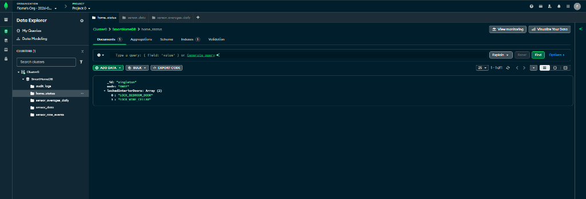

#### 11. Atomic Singleton Document Concurrency Pattern with Optimistic Idempotency
An architectural pattern that stores system-wide operational mode in a dedicated singleton collection with a deterministic fixed primary key (`_id: "singleton"`). This guarantees that concurrent backend containers and distributed worker threads mutate the exact same record without creating phantom duplicate rows or split-brain state.

```java
// Idempotent Singleton State Seeding & Atomic Mutation
Document existing = homeStatus.find(Filters.eq("_id", "singleton")).first();
if (existing == null) {
    homeStatus.insertOne(new Document("_id", "singleton").append("mode", "HOME"));
}
homeStatus.updateOne(Filters.eq("_id", "singleton"), Updates.set("mode", mode));
```

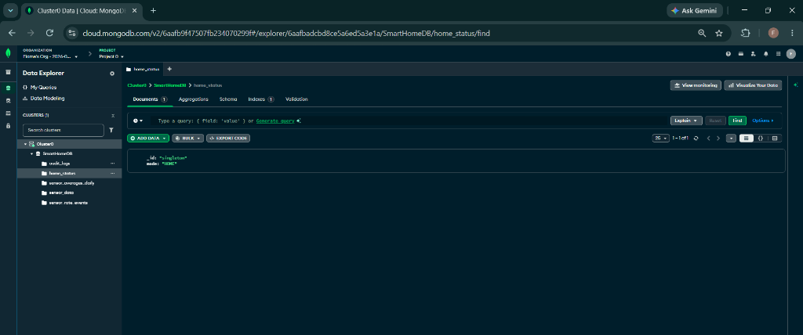

#### 12. High-Performance Partitioned State Aggregation (`$sort` + `$group` + `$$ROOT` + `$replaceRoot`)
Multi-stage aggregation pipeline to retrieve the latest document per partition across all sensors in a single atomic database query.

```java
// Aggregation Pipeline for Latest Reading Per Sensor Partition
List<Document> pipeline = List.of(
        new Document("$sort", new Document("timestamp", -1)),
        new Document("$group", new Document("_id", "$sensorId")
                .append("doc", new Document("$first", "$$ROOT"))),
        new Document("$replaceRoot", new Document("newRoot", "$doc"))
);
collection.aggregate(pipeline);
```

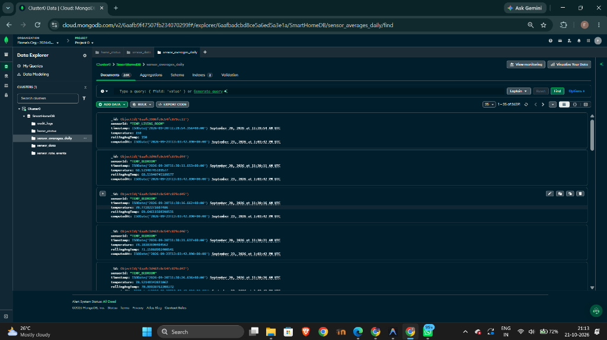

#### 13. Automated 7-Day Storage Lifecycle Retention Policy via Background TTL Expire
Automatic data retention on the main `sensor_data` collection using a 7-day TTL index to prevent disk bloat with zero cron overhead.

```java
// 7-Day Automatic Storage Retention TTL Index
collection.createIndex(
        Indexes.ascending("timestamp"),
        new IndexOptions().expireAfter(7L, TimeUnit.DAYS).name("timestamp_ttl")
);
```

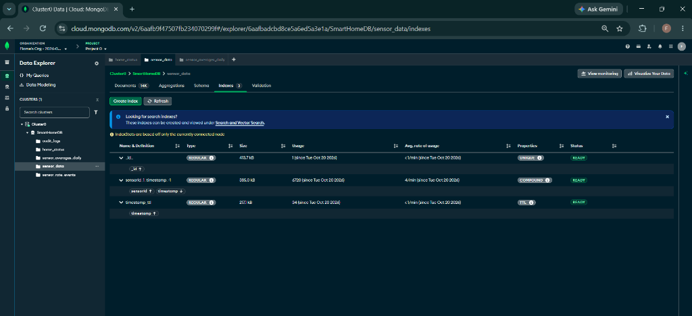
